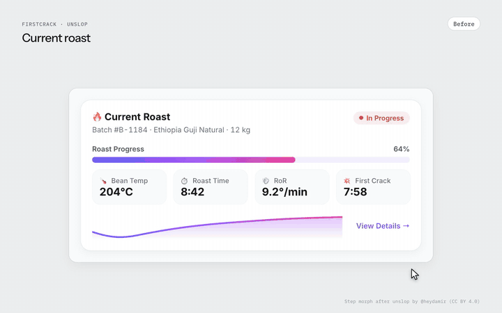
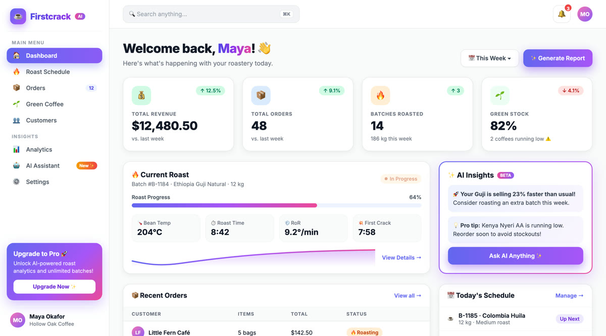
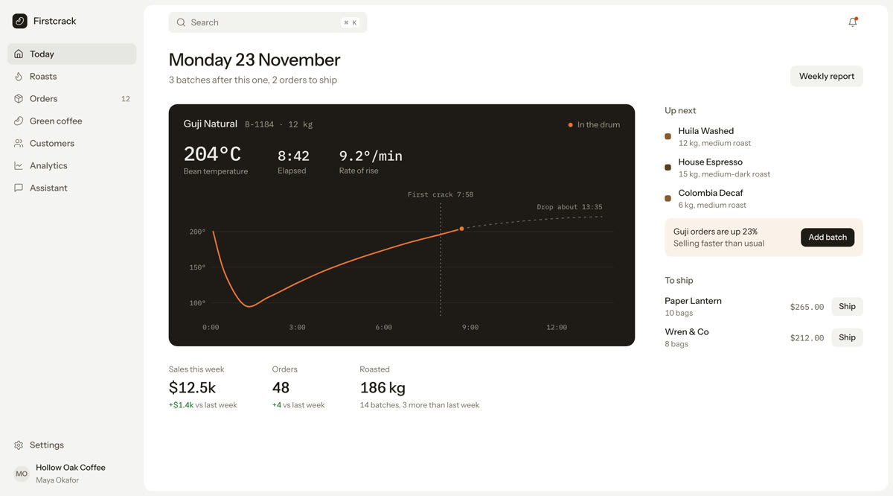
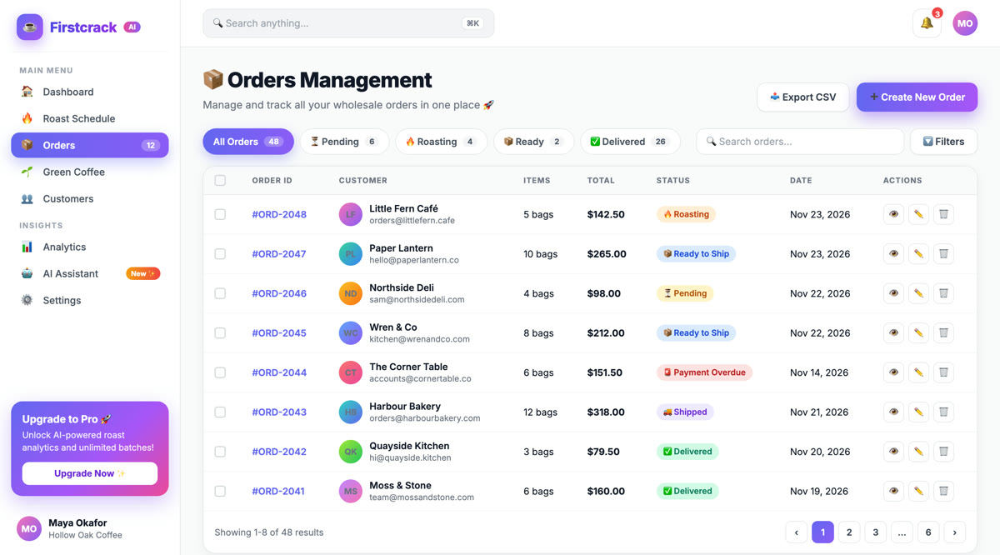
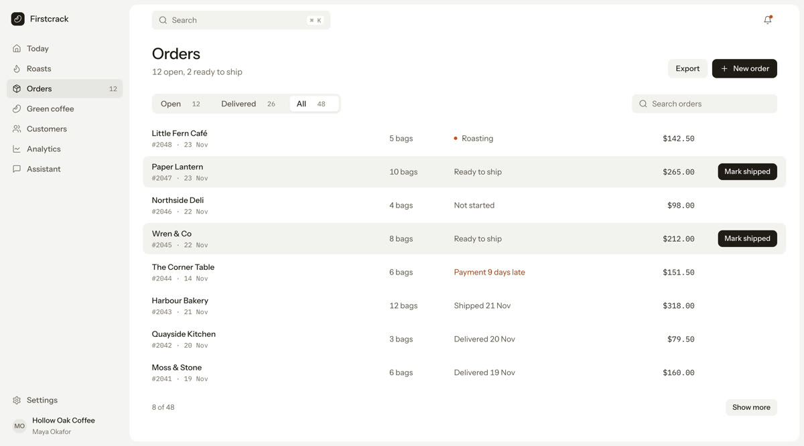
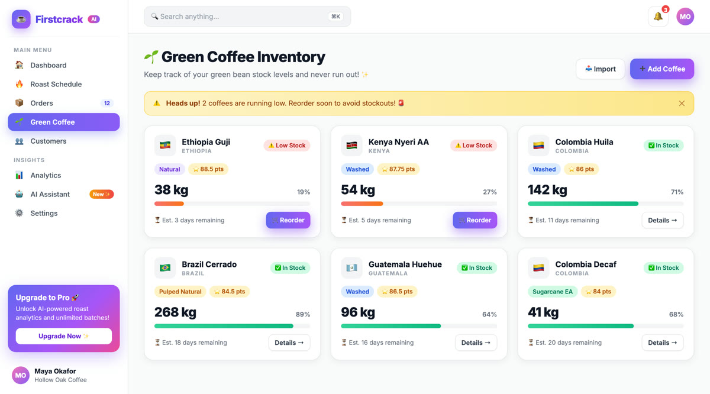
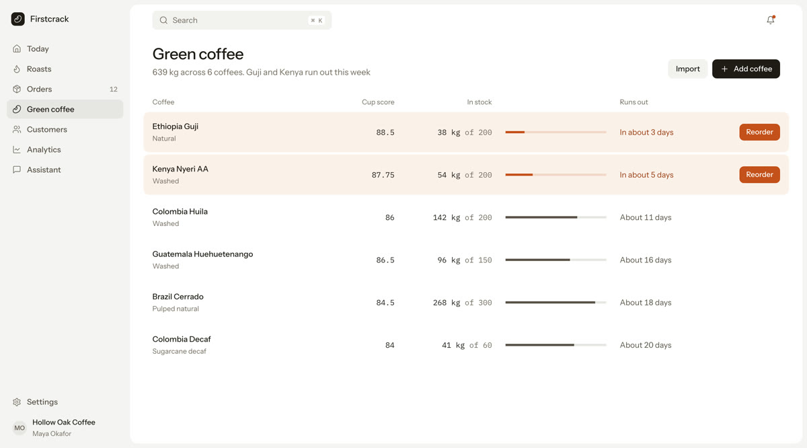

# unslop

A Claude Code skill that takes AI-looking UI and makes it look designed, then shows every change as a before/after guide with step-by-step films.



## What you get

**Full screens**, rebuilt in clean HTML using the product's own font, brand colour and data:

| Default AI build | Unslopped |
|---|---|
|  |  |
|  |  |
|  |  |

**Component films.** For each fix, a cursor goes to the problem, a red labelled box marks it, and the fix morphs in place. Nothing just disappears. The box turns teal and the film moves on to the next step.

**One guide page** with drag-to-compare sliders for the full screens and the films below them, with clickable step lists. Open `examples/firstcrack/guide/index.html` to see one.

Every rebuild is checked with the anti-slop checkers you have installed (Gesso, Taste Skill's inspector, unslop-ui).

## Works on

- A live URL
- Screenshots
- A screen recording
- An app in your own codebase (the rebuilds become the spec)
- Nothing at all: demo mode builds a deliberately default AI-made UI first, then fixes it. The Firstcrack example is entirely fictional.

## Install

```bash
git clone https://github.com/rory4154154/unslop ~/.claude/skills/unslop
cd ~/.claude/skills/unslop && npm install   # Playwright; uses system Chrome on macOS, else: npx playwright install chromium
```

You also need `ffmpeg` and Node 18+.

Then ask Claude Code something like *"unslop this dashboard"*, *"redline these screenshots"* or *"make a before/after design guide for localhost:3000"*.

If you already have heydamir's `unslop` installed in `~/.claude/skills/unslop`, clone this into a different folder (e.g. `~/.claude/skills/unslop-redline`). This skill uses that one as its method, so keep both.

### Recommended companion skills

None of these are required, but the skill runs each one it finds:

- [heydamir/unslop](https://github.com/heydamir/unslop): the nine-pass method
- [unslop-ui](https://github.com/felipebasurto/unslop-ui)
- [Gesso anti-slop](https://github.com/Gesso-Build/skills)
- [Taste Skill](https://github.com/Leonxlnx/taste-skill)
- [Emil Kowalski's skills](https://github.com/emilkowalski/skills)
- [Vercel Web Interface Guidelines](https://github.com/vercel-labs/agent-skills)

## The rules it holds to

These came from real review rounds. The full list is in [references/rules.md](references/rules.md).

- No divider lines by default: space and one tone step do the separating
- A subheader only if the screen doesn't work without it
- Emoji icons become one line-icon set
- Weights 400 and 500 only, and no greeting headlines
- Films morph content into its replacement and never just delete it
- Every end state fits its frame and is obviously better
- Only data that was on the original screen

## Credits

- **[unslop](https://github.com/heydamir/unslop) by Damir Sokolovsky ([@heydamir](https://x.com/heydamir)), CC BY 4.0:** the method, and the step-morph technique the film engine adapts.
- **Checkers and companion skills:** by their respective authors (links above).

## License

[CC BY 4.0](LICENSE). Keep the credit lines, including the one each film carries.
